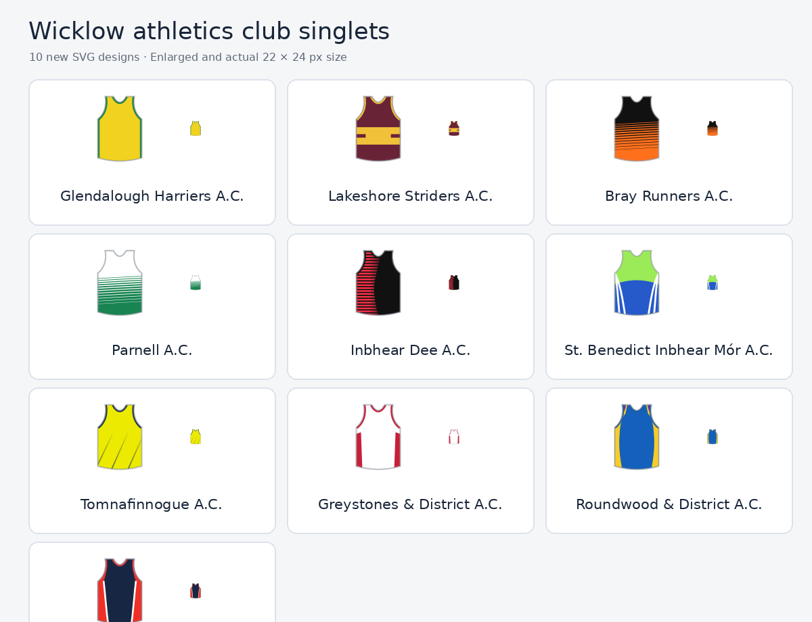

# Wicklow athletics club singlets

A community-made collection of **10 simplified SVG athletics club singlets** for clubs in County Wicklow, Ireland. The illustrations use the same 20 × 22 viewBox and 22 × 24 px display dimensions as the existing singlet icons on [splits.ie](https://splits.ie/).

**[Open the interactive-size preview](index.html)** (or enable GitHub Pages to view it in a browser).

## Contents

- [`svg/`](svg/) — individual, standalone SVG files, one per club.
- [`index.html`](index.html) — gallery comparing enlarged and actual website-size icons.
- [`preview.png`](preview.png) — shareable PNG contact sheet.
- [`club-singlets.json`](club-singlets.json) — exact club display names mapped to SVG file paths.

## Included clubs

Glendalough Harriers A.C., Lakeshore Striders A.C., Bray Runners A.C., Parnell A.C., Inbhear Dee A.C., St. Benedict Inbhear Mór A.C., Tomnafinnogue A.C., Greystones & District A.C., Roundwood & District A.C., and Aughrim A.C.

Kilcoole A.C. and Sli Cualann A.C. already have icons on splits.ie, so neither is included here.

## Implementation notes

- SVGs are stand-alone files with unique clip-path and gradient IDs **between clubs**.
- For reuse of the *same* club SVG multiple times on a page, prefer `` or ensure IDs are unique for each inline instance.
- In an existing SVG rendering function, paths and colours can be copied into the site's component, rather than adding another image pipeline.
- Some clubs may have different names or aliases in the site's database. Match them explicitly before integration.
- Designs are simplified approximations based on reference kit photographs, with crests, wording, and race bibs deliberately omitted; not official club assets.

## References

- [Athletics Wicklow — Meet the Clubs](https://www.athleticswicklow.com/meet-the-clubs) (reference for the club list)
- Club kit reference photos supplied during design (not redistributed here)

## GitHub publishing

Create a new GitHub repository, upload the **contents** of this folder (not the enclosing folder), and commit. The README and preview image will appear automatically on the repository homepage. To publish the gallery as a webpage, turn on **Settings → Pages → Deploy from a branch**, select `main` and `/ (root)`.
